<p align="center">
  
</p>

<h1 align="center">ShardKit</h1>

[English](./README.md) · [简体中文](./README.zh-CN.md)

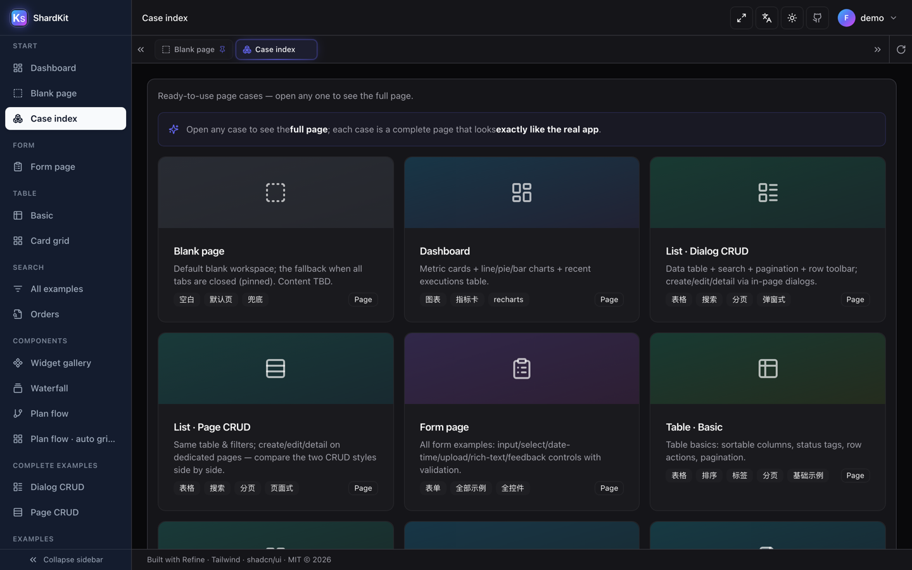

> **A copy-in UI shard kit — browse, preview, ship.**
> A searchable, previewable gallery of **finished page cases** and UI components.
> Not an npm dependency. You **copy the code in**.

<p align="center">
  <a href="./LICENSE"></a>
  
  
  
  
  
  
</p>

<p align="center">
  
  
  
  
  
  
  
  
</p>

<p align="center">
  
  
  
  
  
  
  
</p>

<p align="center">
  
  
  
  
</p>

**ShardKit** = *shard* (a reusable UI fragment) + *kit* (the toolbox that organizes them).

It is **not** a component library you `npm install`. It is a **live gallery** where fragments are
classified, searched, previewed — and then **copied into your own project**.

Baseline stack: **Refine (headless) + Tailwind CSS + shadcn/ui**. The registry is stack-agnostic;
other stacks can be indexed the same way.

---

## Why

UI assets rot in old repos. Need a button, a form layout, an empty state — you go archaeology.

ShardKit's answer: **a museum + a search desk + a set of runnable page cases**.
*See it, find it, copy it.*

## What it is / is not

| | |
|---|---|
| **Is** | A standalone open-source project: a searchable, previewable gallery of UI components **and finished pages**, runnable end to end |
| **Is not** | Not another npm component library; not bound to any product's business domain |
| **Audience** | Developers / teams / agents who need to *find* a reusable UI fragment and *lift* it |
| **Consumption** | **Copy-in** — copy the source files you need into your project. **No `npm install shardkit`** |

## Consumption model (copy-in)

Same philosophy as shadcn/ui. ShardKit is its *organizing + searching* layer.

1. **Minimum copy unit** = one directory `registry-items/<id>/`
   - `index.tsx` — the source, copy and use
   - `demo.tsx` — the live preview (the detail page renders this)
   - `meta.json` — declared `deps`, `files`, `usability`
2. Every entry declares its dependencies and placement explicitly.
3. To consume: copy `index.tsx` into your project, install the declared `deps`, done.
   **You never add ShardKit as a dependency.**

## Features

- **Registry-driven** — add a component = drop a `registry-items/<id>/` directory and run
  `node scripts/build-registry.mjs`. No page code changes.
- **Live preview** — detail pages render the real component, not a screenshot.
- **Multi-dimensional search** — category tree + tag multi-select + fuzzy keyword search.
- **Page cases first** — every case is a complete, runnable page that looks like a real app.
- **Two CRUD layouts side by side** — dialog-based (`/list`) and page-based (`/list-page`),
  sharing one form and one in-memory store.
- **DAG visualization** — `/plan-flow` renders real plan exports with playback, collapsible
  subtrees, auto-fit layouts and viewport follow.
- **Bilingual UI** — `zh-CN` / `en-US`, auto-detected from the browser, switchable in the header.
- **Offline by design** — no CDN, no runtime network calls; icons are bundled `lucide-react`.

## Tech stack

Every row below is **actually imported** by the source in `src/` — no "came with the template" leftovers.

| Layer | Technology | Version | Used for |
|---|---|---|---|
| App shell & data | **Refine** (headless) | 4.57 | routing + data layer, zero UI opinions — the UI is all ours |
| UI runtime | **React** | 18.3 | every page and primitive |
| Language | **TypeScript** | 5.6 | strict mode; `tsc -b` gates the build |
| Build / dev | **Vite** | 5.4 | dev server on `:5178`, production build |
| Styling | **Tailwind CSS** | 3.4 | layout, spacing and color — all through design tokens, no ad-hoc hex |
| Primitives | **shadcn/ui** pattern | copy-in | 42 primitives in `src/components/ui/`, copied in rather than installed |
| A11y behaviour | **Radix UI** | 14 packages | dialog / select / tabs / tooltip — keyboard, focus trap, ARIA |
| Routing | **React Router** | 6.27 | nested routes + the multi-tab workspace |
| Server state | **TanStack Query** | 5.59 | cache, loading and error states in the case pages |
| DAG canvas | **React Flow** (`@xyflow/react`) | 12 | `/plan-flow` graph: pan/zoom, custom nodes, playback |
| Auto layout | **dagre** | 3.1 | layered layout of the plan graph before the custom column pass |
| Charts | **Recharts** | 2.15 | dashboard widgets |
| Rich text | **Tiptap** | 3.31 | editor case |
| Markdown input | **@uiw/react-md-editor** | 4.1 | markdown editor case |
| Icons | **Lucide** | 0.454 | one icon set across the whole repo, tree-shaken |
| Variant API | **cva + tailwind-merge + clsx** | 0.7 / 2.5 / 2.1 | the `variant` / `size` props every primitive exposes |
| i18n | **i18next + react-i18next** | 23 / 15 | zh-CN + en-US, both bundled at build time (no runtime fetch) |
| E2E | **Playwright** | 1.63 | 28 `scripts/verify_*.mjs` gates run headless against a real browser |
| Build scripts | **Node** | ≥ 20 | generate `registry/index.json` and page bundles from `registry-items/` |

> Deliberately **not** used: any CSS-in-JS runtime, any state-management library, any UI kit that
> ships its own visual language. If you copy a shard out, the only thing it drags along is Tailwind
> classes and Radix primitives.

## Screenshots

### Plan flow — DAG visualization with playback

`/plan-flow` renders a real plan export (137 nodes) as a DAG: auto-collapsed into 17 mainline
columns, auto-fit to one screen, subtrees collapsible, and playback that **glides the viewport to
keep the currently executing node centered** while finished edges light up green.

| Overview — auto-collapsed & fit to one screen | Playback — current node held at center |
|---|---|
| 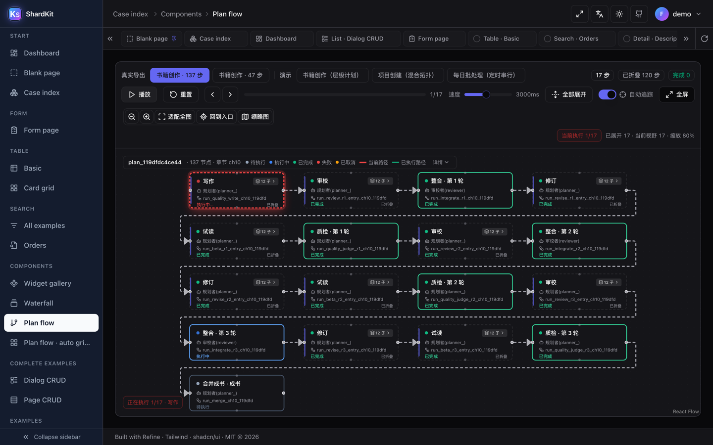 | 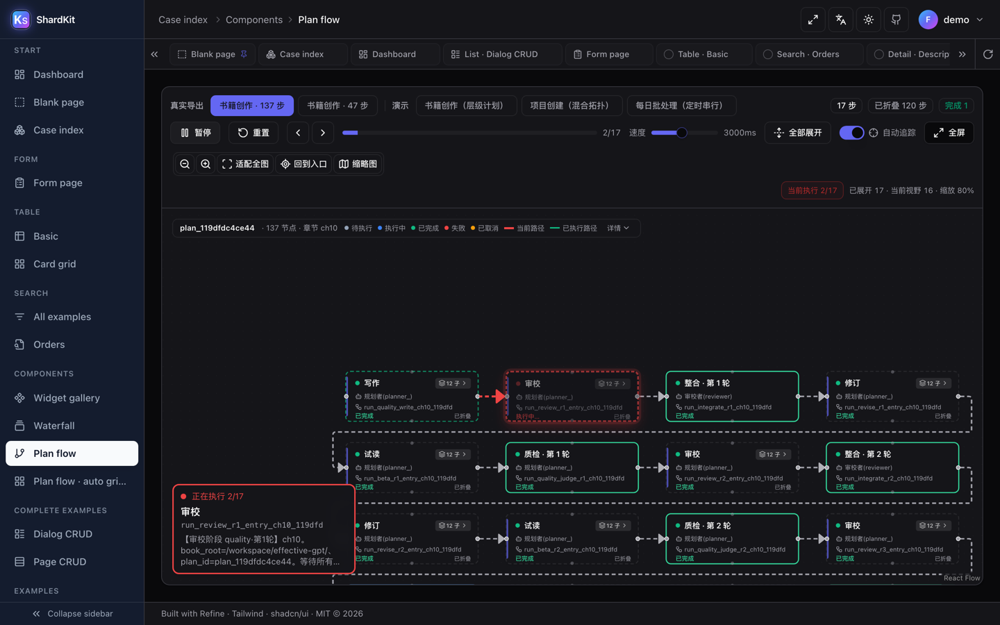 |

| Another topology (fan-out + join) | Fullscreen presentation mode |
|---|---|
| 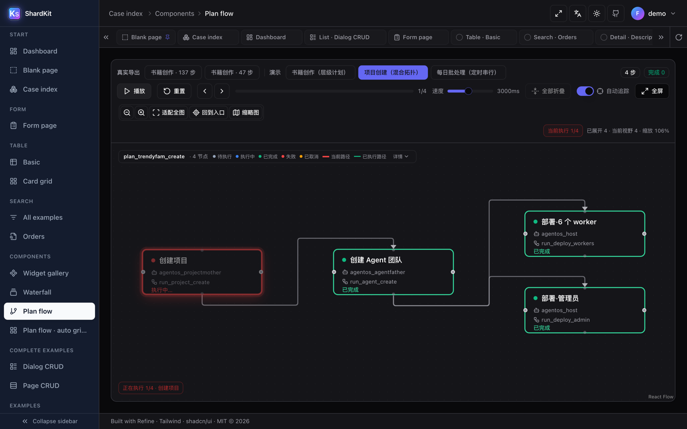 | 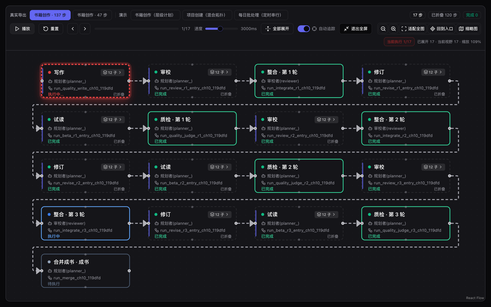 |

### Page cases

| Dashboard | List · dialog CRUD |
|---|---|
| 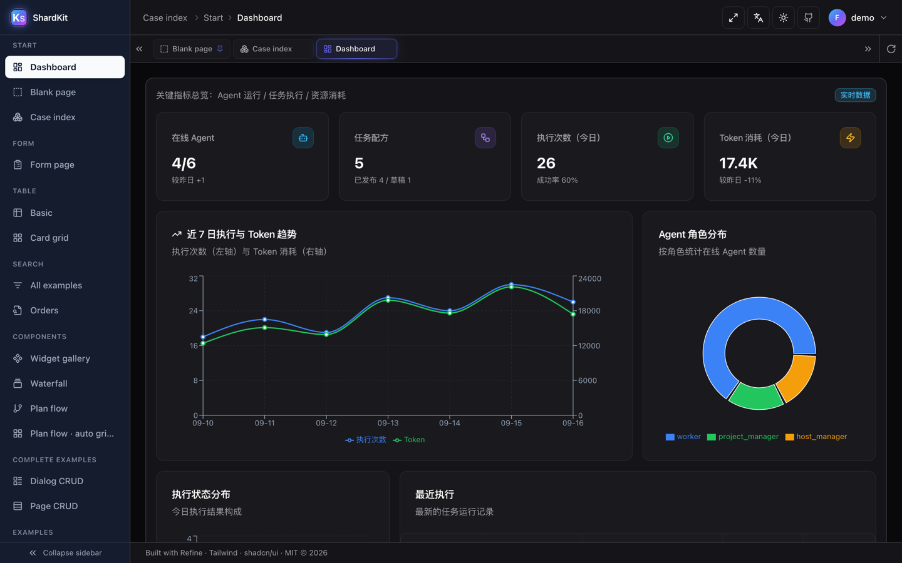 | 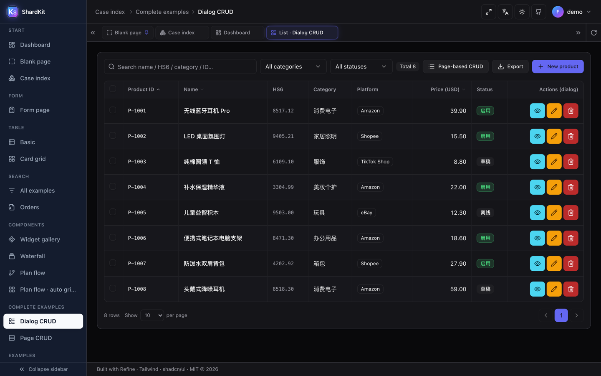 |

| Form page | Table · basic |
|---|---|
| 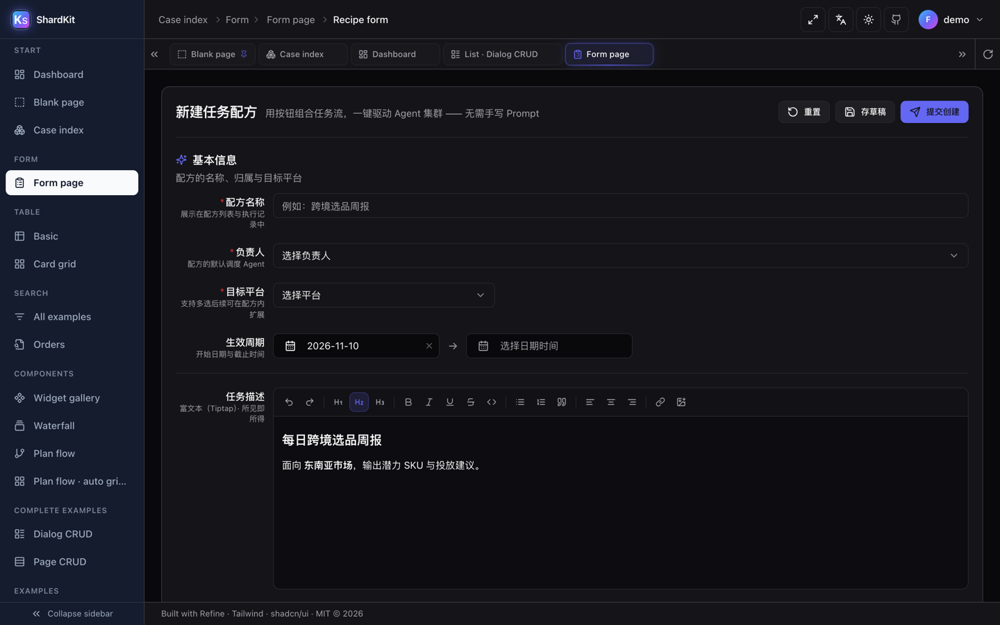 | 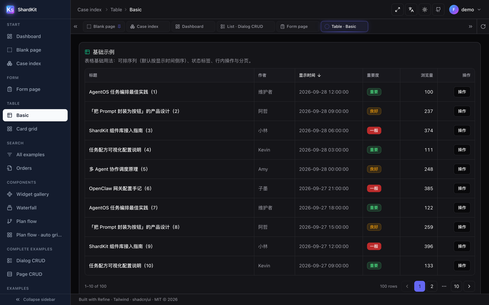 |

| Search · orders | Detail · read-only |
|---|---|
| 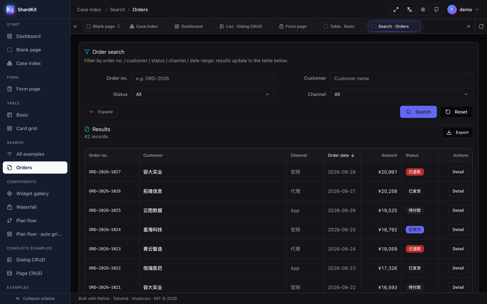 | 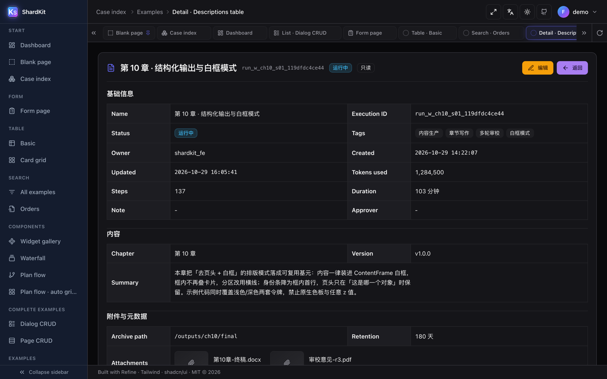 |

### Components

| Widget gallery | Form controls (all examples) |
|---|---|
| 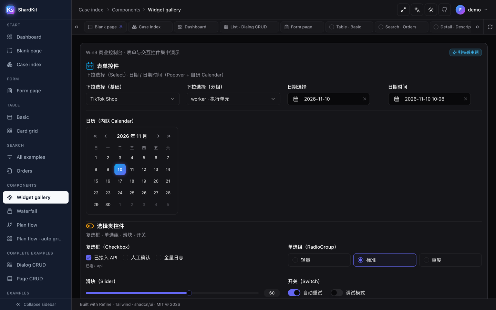 | 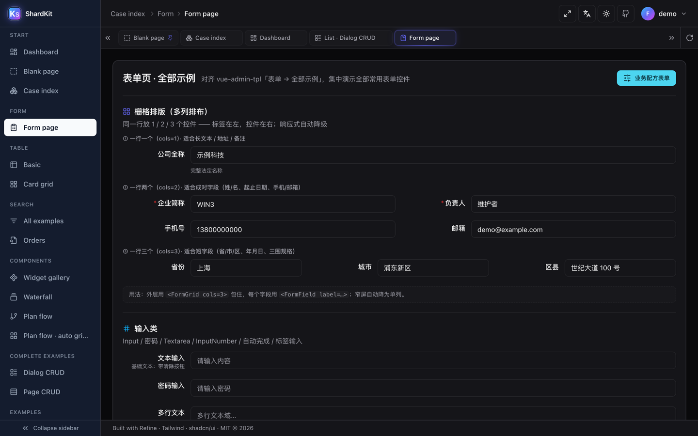 |

## Quick start

```bash
npm install          # install dependencies
npm run dev          # build metadata + start Vite → http://localhost:5178/
npm run build        # production build (tsc type-check + vite build)
npm run preview      # preview the production build → http://localhost:4178/
```

Requires **Node.js >= 20**.

## Project structure

```
shardkit/
├── registry-items/            # ★ the copy-in units — one directory per entry
│   └── <id>/{index.tsx,demo.tsx,meta.json}
├── registry/                  # the search "database"
│   ├── schema.json            # public data contract for an entry
│   ├── index.json             # generated full index (committed on purpose)
│   └── items/
├── src/                       # the gallery SPA (Refine + Tailwind + shadcn)
│   ├── pages/cases/*          # finished page cases
│   ├── components/ui/*        # 42 shadcn-style primitives
│   ├── components/shell.tsx   # app shell: sidebar + tabs + header
│   ├── lib/{registry,cases}   # registry & case metadata
│   └── i18n/                  # locales (zh-CN / en-US)
├── scripts/                   # build + verification scripts
├── agent_doc/                 # engineering docs (design rules, i18n guide, architecture)
├── assets/screenshots/        # README images (en/ for this file, zh-CN/ for the Chinese README)
└── public/                    # static assets, generated bundles
```

## Adding a component

1. Create `registry-items/<id>/` (lowercase, hyphenated — e.g. `button-primary`).
2. Add `index.tsx` (copy-ready source), `demo.tsx` (preview), `meta.json` (metadata).
3. Run `node scripts/build-registry.mjs`.
4. The entry appears in the gallery and is searchable — **no page code to touch**.

Full field list: [`registry/schema.json`](./registry/schema.json).
Step-by-step guide: [`CONTRIBUTING.md`](./CONTRIBUTING.md).

## Internationalization

`i18next` + `react-i18next`, locale packs bundled — **zero network calls at runtime**.

| | |
|---|---|
| Locales | `zh-CN` (source) · `en-US` |
| First visit | detected from `navigator.language`; unrecognized → English |
| Persistence | `localStorage["shardkit.locale"]`, synced to `<html lang>` |
| Packs | `src/i18n/locales/{zh-CN,en-US}.ts` (281 keys, 14 namespaces) |

**Scope, stated honestly:** the *framework layer* is fully translated — navigation, tabs,
breadcrumbs, table headers, detail field labels, list/search toolbars, pagination, buttons,
empty states, form labels and validation. **Example page content** (mock data, demo copy) is
Chinese-first; `agent_doc/国际化-i18n改造指南.md` lists every remaining file and ships a
ready-to-paste prompt for finishing the job with an agent.

## Verification

UI correctness here is measured, not eyeballed. Scripts drive Playwright and assert numbers.

```bash
npx tsc -b                                       # type check (exit code 0)
node scripts/check-ui-rules.mjs                  # design-token / class-name budget
node scripts/verify_surfaces.mjs                 # surface contrast + layering
node scripts/verify_content_frame_20261028.mjs   # 26 routes, asserts 0 page errors
node scripts/verify_plan_flow.mjs                # plan-flow regression (zoom, folding, fit)
```

Most scripts need the dev server running on port 5178.

## Docs

| Document | Contents |
|---|---|
| [`agent_doc/usage-manual.md`](./agent_doc/usage-manual.md) | Project manual: directory map, workflows, conventions |
| [`agent_doc/architecture.md`](./agent_doc/architecture.md) | Architecture, server-side options, data flow |
| [`agent_doc/国际化-i18n改造指南.md`](./agent_doc/国际化-i18n改造指南.md) | i18n guide: coverage, five hard rules, remaining backlog |
| [`agent_doc/计划任务流程图-使用文档.md`](./agent_doc/计划任务流程图-使用文档.md) | Plan flow (DAG) component manual |
| [`CHANGELOG.md`](./CHANGELOG.md) | Release notes |

## Roadmap

- [x] **M0** Skeleton: directory layout, registry schema, build scripts
- [x] **M1** Gallery SPA (Refine + Tailwind + shadcn) + registry-driven loop
- [x] **M3** Page cases: dialog CRUD, page CRUD, dashboard, forms, tables, plan flow
- [ ] **M2** Fuzzy search (Fuse.js) + multi-facet filtering
- [ ] **M4** Governance + static publishing

## Contributing

Read [`CONTRIBUTING.md`](./CONTRIBUTING.md). Adding an entry is the main path; UI changes
should keep the verification scripts green.

## Brand assets

| File | Size | Use |
|---|---|---|
| [`public/logo.svg`](./public/logo.svg) | vector | **Single source** — favicon and the in-app brand mark |
| [`assets/logo.png`](./assets/logo.png) | 512×512 | Raster logo for READMEs, slides, third-party listings |
| [`assets/social-preview.png`](./assets/social-preview.png) | 1280×640 | GitHub repo social preview (Settings → Social preview) |
| `public/favicon.ico` | 16–256 | Legacy browsers, RSS readers, link unfurlers |

The mark is a capital **K** plus a lowercase **s** (ShardKit) in white on a blue→violet gradient.
Every PNG/ICO above is **generated** from `logo.svg` — regenerate with:

```bash
node scripts/rasterize_logo.mjs
```

Do not hand-edit the bitmaps: the output is byte-for-byte reproducible, so any manual
touch-up will silently drift from the vector.

## License

[MIT](./LICENSE) © 2026 ShardKit contributors.
