<p align="center">
  
</p>

<h1 align="center">ShardKit</h1>

**English** · [简体中文](./README.zh-CN.md)

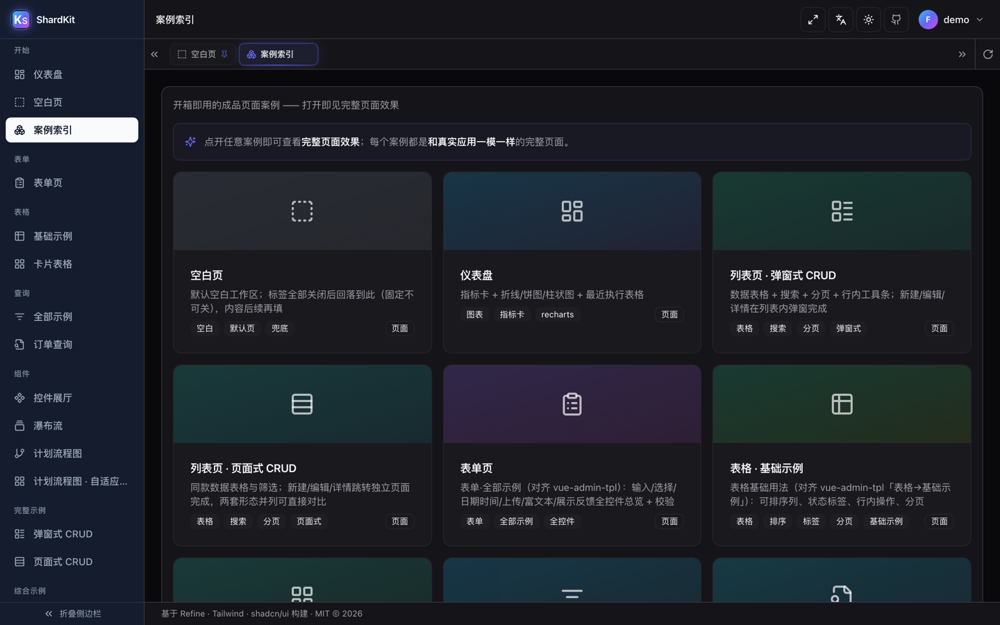

> **A copy-in UI shard kit — browse, preview, ship.**
> 一个**可检索、可预览**的 UI 组件与**成品页面案例集**（"活样板间"）。
> 从根上解决"找按钮 / 找交互 / 调页面"难题。

<p align="center">
  <a href="./LICENSE"></a>
  
  
  
  
  
  
</p>

<p align="center">
  
  
  
  
  
  
  
  
</p>

<p align="center">
  
  
  
  
  
  
  
</p>

<p align="center">
  
  
  
  
</p>

**ShardKit** = *shard*（可独立复用的 UI 碎片）+ *kit*（工具箱）。
它**不是**一个 npm 组件库，而是一个**带分类 + 实时预览 + 多维检索的组件目录与成品页面案例集**——
碎片在这里被组织、被检索、被预览，再以 **copy-in** 的方式复用到你的项目里。

技术栈基线：**Refine (Headless) + Tailwind CSS + shadcn/ui**（可扩展 index 其它技术栈资产）。

---

## 为什么做（Problem）

UI 组件的知识/资产散落在无数历史项目与代码库中，缺乏统一、可检索、带预览的索引。
每次复用一个按钮或交互，都要重新"考古"。

**ShardKit 的答案**：组件博物馆 + 检索台 + 成品页面案例集 ——
*看到即所得、搜到即定位、打开即见整页效果。*

## 定位（What it is / is not）

| | |
|---|---|
| **是** | 一个**独立开源项目**：可检索 / 可预览的 UI 组件与成品页面案例集 |
| **不是** | 不是又一个 npm 依赖库；不绑定任何特定业务或产品术语 |
| **消费者** | 任何需要「找可复用 UI 片段」的开发者 / 团队 / Agent |
| **消费方式** | **copy-in**：从本仓 **复制需要的代码**到你自己的项目开发（**不做 npm 依赖安装**） |

## 消费方式（copy-in · 核心约定）

> 与 **shadcn 式「copy-in」理念完全一致**。ShardKit 是它的"组织层 + 检索层"。

1. **最小可复制单元** = `registry-items/<id>/` 一个目录
   - `index.tsx`（源码，复制即用）+ `demo.tsx`（预览）+ `meta.json`（依赖/放置说明）
2. **每个条目显式标注**：`deps`（需装的依赖）、`files`（复制哪些文件）、`usability`（复用成本）
3. **消费方用法**：从本仓对应条目目录，把 `index.tsx` 复制进你的工程（放到约定目录），
   按 `deps` 装依赖即可运行 —— **无需把整个 ShardKit 作为依赖安装**。

## 核心机制

1. **注册表驱动** — 新增组件 = 放一份 `registry-items/<id>/`（meta.json + 源码 + demo），
   跑 `node scripts/build-registry.mjs` 即入索引，**无需改页面代码**。
2. **实时预览** — 详情页动态渲染真组件（非截图）。
3. **多维检索 + 全局搜索** — 分类树 + 标签多选 + 关键词模糊搜索三合一。
4. **成品页面优先** — 每个案例页都是与真实应用一致的完整页面，打开即见整页效果。

## 技术栈

下表每一行都在 `src/` 里**真正被 import**——没有"脚手架自带但没人用"的凑数项。

| 层 | 技术 | 版本 | 用在哪 |
|---|---|---|---|
| 应用骨架 / 数据层 | **Refine**（headless） | 4.57 | 路由 + 数据层，**零 UI 主张**——界面全是我们自己的 |
| UI 运行时 | **React** | 18.3 | 所有页面与基元 |
| 语言 | **TypeScript** | 5.6 | strict 模式，`tsc -b` 不过就不让构建 |
| 构建 / 开发 | **Vite** | 5.4 | dev server `:5178`、生产构建 |
| 样式 | **Tailwind CSS** | 3.4 | 布局/间距/配色全部走设计令牌，不写零散 hex |
| 基元层 | **shadcn/ui** 模式 | copy-in | `src/components/ui/` 下 42 个基元，**复制进来**而不是装依赖 |
| 无障碍行为 | **Radix UI** | 14 个包 | dialog / select / tabs / tooltip——键盘、焦点陷阱、ARIA 都现成 |
| 路由 | **React Router** | 6.27 | 嵌套路由 + 多标签工作区 |
| 服务端状态 | **TanStack Query** | 5.59 | 案例页的缓存 / loading / error 态 |
| DAG 画布 | **React Flow**（`@xyflow/react`） | 12 | `/plan-flow`：平移缩放、自定义节点、回放 |
| 自动布局 | **dagre** | 3.1 | 计划图的层次布局（之后再过一遍自研分列算法）|
| 图表 | **Recharts** | 2.15 | 仪表盘指标卡与图表 |
| 富文本 | **Tiptap** | 3.31 | 编辑器案例 |
| Markdown 输入 | **@uiw/react-md-editor** | 4.1 | Markdown 编辑器案例 |
| 图标 | **Lucide** | 0.454 | 全仓单一图标集，按需 tree-shake |
| 变体 API | **cva + tailwind-merge + clsx** | 0.7 / 2.5 / 2.1 | 每个基元的 `variant` / `size` 属性 |
| 国际化 | **i18next + react-i18next** | 23 / 15 | zh-CN + en-US，语言包**打进 bundle**，运行时零联网 |
| 端到端 | **Playwright** | 1.63 | 28 个 `scripts/verify_*.mjs` 验收脚本，无头浏览器跑真页面 |
| 构建脚本 | **Node** | ≥ 20 | 从 `registry-items/` 生成 `registry/index.json` 与页面产物 |

> **故意没用**的东西：任何 CSS-in-JS 运行时、任何状态管理库、任何自带视觉语言的 UI kit。
> 所以从这儿复制一个 shard 走，它牵着走的只有 Tailwind 类名和 Radix 基元。

## 截图

### 计划流程图 —— DAG 可视化 + 回放

`/plan-flow` 把真实计划导出（137 节点）渲染成 DAG：自动折叠成 17 个主链列、自适应铺满一屏、
子树可折叠；回放时**视口平滑跟随，当前执行节点始终居中**，已流转的路径亮绿。

| 总览 —— 自动折叠 + 一屏适配 | 播放中 —— 当前节点保持居中 |
|---|---|
| 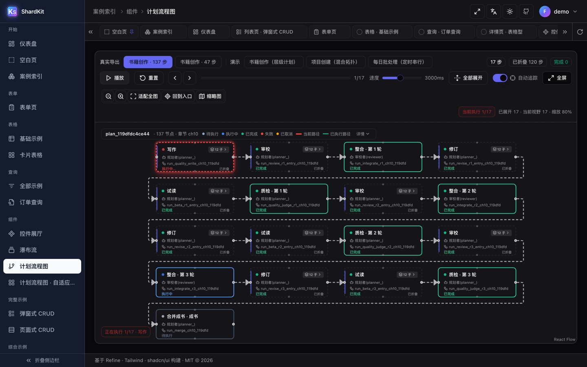 | 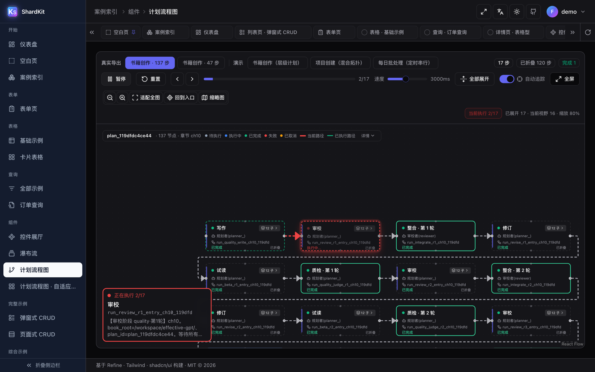 |

| 另一种拓扑（扇出 + 汇合） | 全屏演示模式 |
|---|---|
| 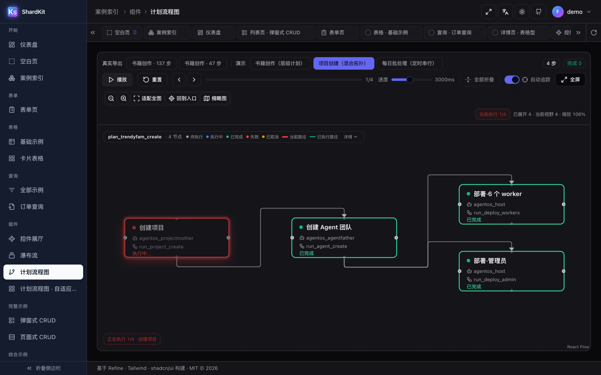 | 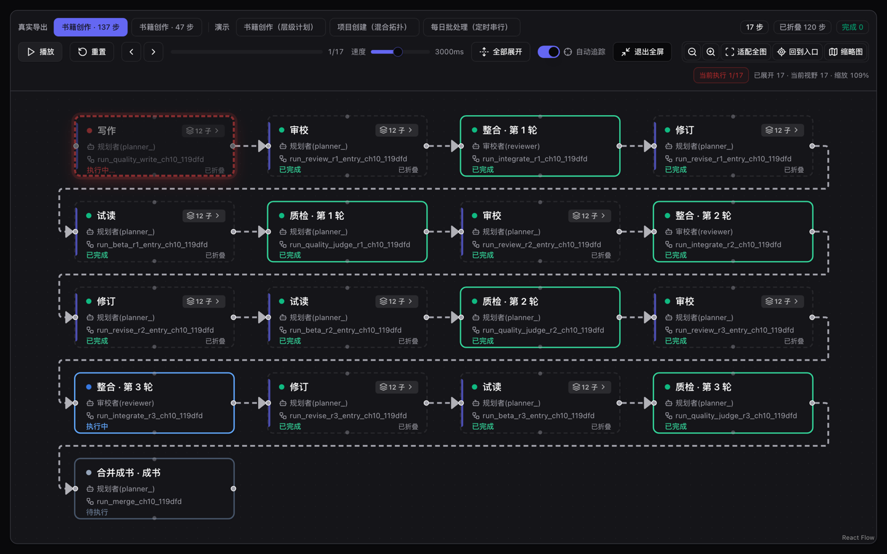 |

### 页面案例

| 仪表盘 | 列表页 · 弹窗式 CRUD |
|---|---|
| 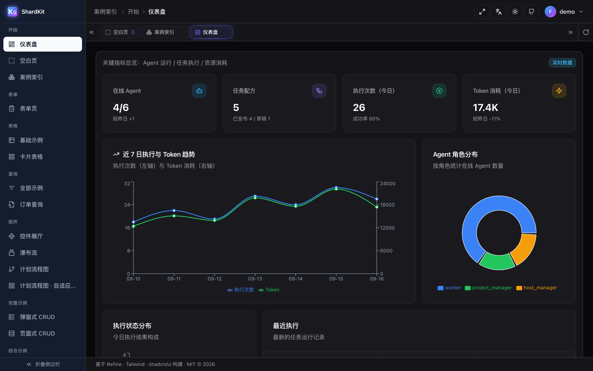 | 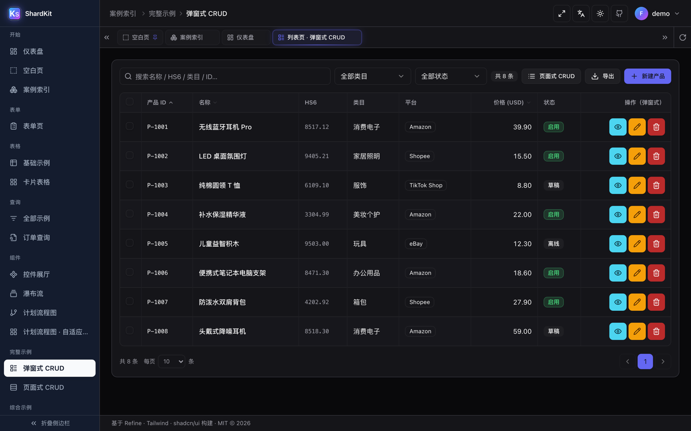 |

| 表单页 | 表格 · 基础示例 |
|---|---|
| 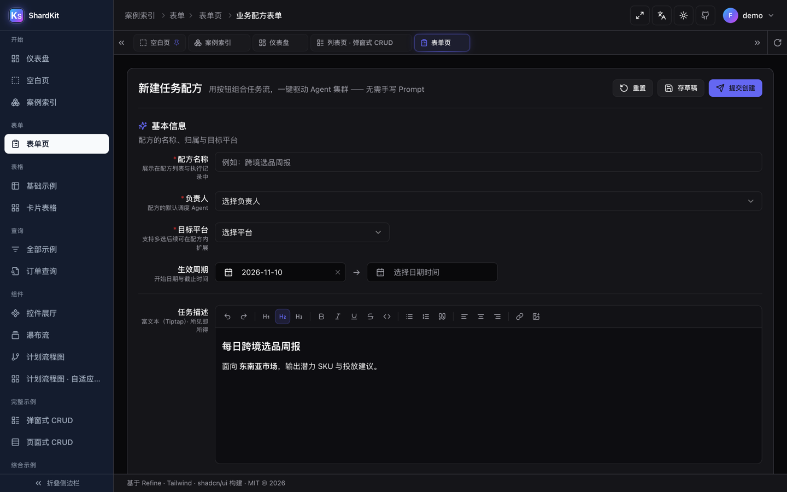 | 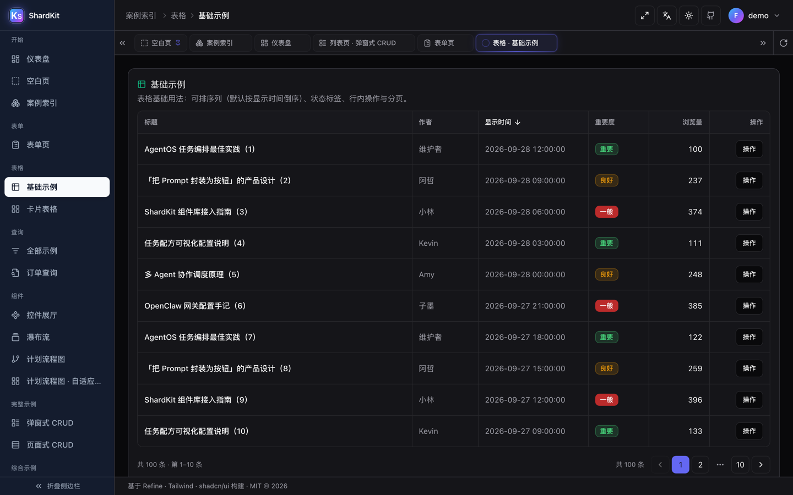 |

| 查询 · 订单 | 详情 · 只读展示 |
|---|---|
| 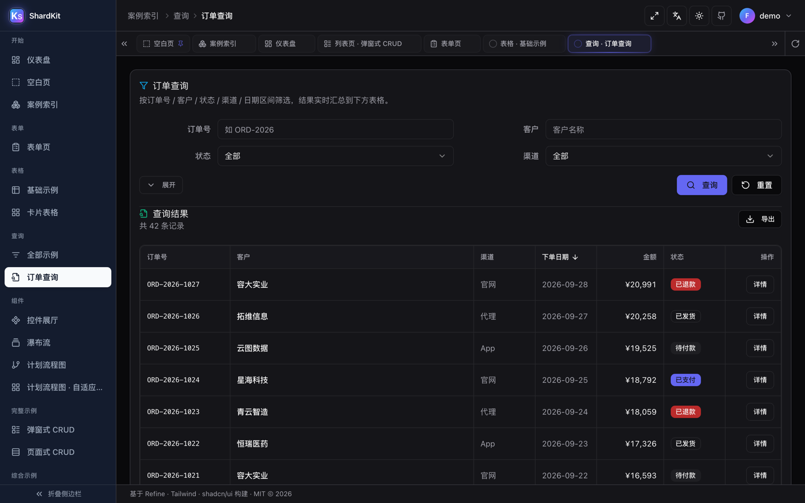 | 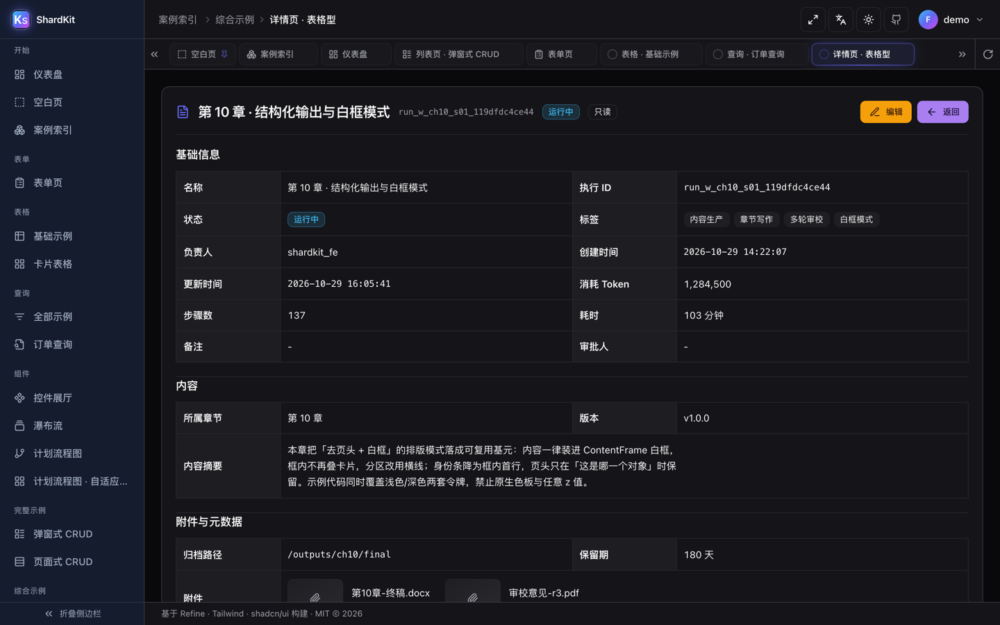 |

### 控件

| 控件展厅 | 表单控件（全部示例）|
|---|---|
| 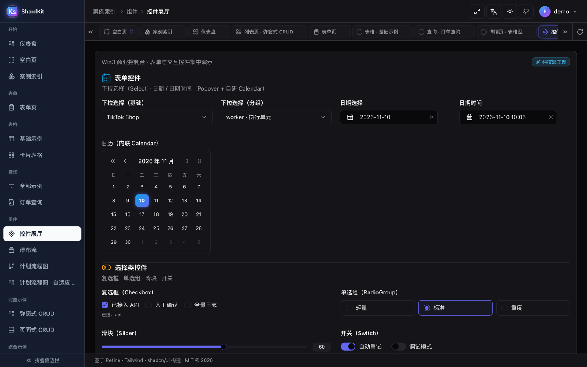 | 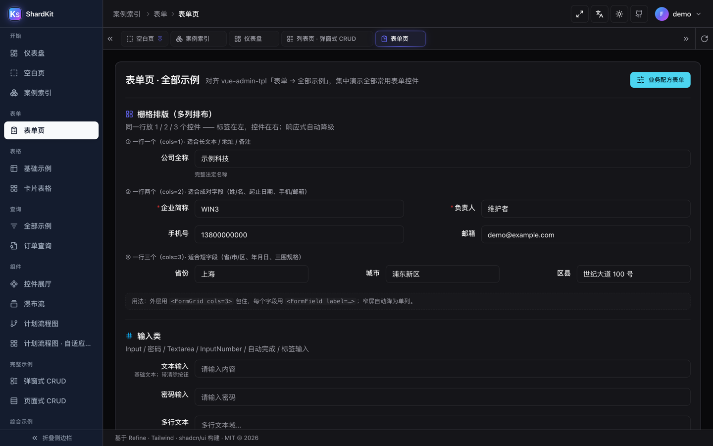 |

## 图标方案约定（2026-09-29 维护者定）

**首选 `lucide-react`（本地 SVG 组件，运行时零联网）。**

| 项 | 约定 |
|----|------|
| **图标来源** | 统一用 `lucide-react`（shadcn 官方推荐，本地 npm 包内 SVG 组件）|
| **联网** | ❌ 不联网 —— 图标打包进 bundle，运行时无 CDN/API 请求 |
| **优点** | tree-shaking 好、离线/内网可跑、无第三方请求（商业控制台合规友好）|
| **挑图标** | 用 <https://lucide.dev/icons/> 搜索；跨库找可用 <https://icon-sets.iconify.design/> 浏览 |
| **需要跨图标库时** | 才引入 `@iconify/react`，**必须配 `@iconify-json/<set>` 走离线模式**；**禁止**用默认在线 API 模式（`api.iconify.design`，内网会加载不出图标）|

> ⚠️ Iconify 是**开源图标库聚合框架**（不是 AI 生成图标）：`iconify.design` 只是挑图标用的搜索站；
> 其默认 `@iconify/react` **走在线 API**（会联网），故本项目默认不用，除非配离线包。

## 国际化约定（i18n · 2026-09-29 维护者定）

**技术栈：`i18next` + `react-i18next`（语言包打进 bundle，运行时零联网）。**

| 项 | 约定 |
|----|------|
| **语言** | 简体中文（`zh-CN`）/ English（`en-US`）—— 首次访问**按浏览器语言自动选择**，认不出的语言回落英文 |
| **入口** | 顶栏语言按钮（Languages 图标）下拉切换，切换后即时生效 |
| **持久化** | `localStorage["shardkit.locale"]`，手动选择后优先于浏览器语言；同时同步 `<html lang>` |
| **语言包** | `src/i18n/locales/zh-CN.ts` / `en-US.ts`（key 结构严格一一对应）|
| **初始化** | `src/i18n/index.ts`，`main.tsx` 里 `import "./i18n"` 即生效 |
| **取词** | 组件内 `const { t } = useTranslation(); t("nav.sectionPages")` |
| **切换** | `changeLocale("en-US")`（写 i18n + localStorage + `<html lang>`）|

### 翻译范围（方案 A：只翻「框架层」）

**只翻框架层**，业务示例内容保持中文：

| 翻 ✅ | 不翻 ❌（保持中文）|
|------|------|
| 侧边导航分组/条目、标签栏标题、页脚 | 案例卡上的 **tag 标签**（内容分类）|
| 公共按钮/提示（确定/取消/关闭/全屏/主题…）|
| 页面标题与描述（案例索引等）| 多级菜单 demo 里的示例菜单树（工作台/系统设置/帮助）|
| 用户菜单（个人中心/文档/锁屏/退出）|
| 标签栏右键菜单（刷新/关闭其他/关闭右侧…）| 各案例页内部的业务示例文案 |

> 案例标题/描述的英文放在 `src/lib/cases.ts` 的 `titleEn` / `descEn`（缺省回退中文），
> 由 `caseTitle(c, lang)` / `caseDesc(c, lang)` 按语言取。导航/标签栏均走它。

**新增可翻文案的标准流程：**
1. 在 `src/i18n/locales/zh-CN.ts` 与 `en-US.ts` 的对应命名空间下各加一条（key 完全一致）；
2. 组件里 `t("namespace.key")` 调用。

> 验收：`scripts/verify_i18n_20260929.mjs`（默认简中 / 切换生效 / 持久化 / `<html lang>` /
> 标签栏随语言变 / 无缺失 key / 0 console error）。

## 形态：成品页面案例集（2026-09-16 维护者纠偏）

ShardKit 的形态是**成品页面案例集**（不是组件工具箱）：

- 左侧导航按**页面类型**组织：案例索引 / 仪表盘 / 列表 / 表单 / 详情 / 认证 / 错误 / 组件 / 区块；
- 每个导航项 = 一个**完整可运行的页面案例**，打开即见整页效果；
- **组件已下沉到页面** —— 不再有独立「底层组件」导航层；
- **页面即为一个纯粹的真实应用页面** —— 顶部不挂任何「取用 / 元数据」UI（「页面·目标」
  徽章、「复制页面源码 / 一键打包复制本页」按钮、「本页零件」区块等已全部移除）。

## 列表案例：两套完整 CRUD（两个并列菜单入口）

列表案例拆为**两个并列的侧边栏菜单项**（对齐参照项目 `vue-admin-tpl` 的 `example-dialog` / `example-page`
结构），一眼可区分两套形态，且共享同一份数据源：

| 菜单项 | 路由 | 形态 |
|--------|------|------|
| 列表页 · 弹窗式 CRUD | `/list` | 列表内弹窗完成新建/编辑/详情/删除 |
| 列表页 · 页面式 CRUD | `/list-page` | 新建/编辑/详情跳转独立页面完成 |

两种形态的能力对照：

| 能力 | Dialog 式（`/list`） | Page 式（`/list-page`） |
|------|----------------------|-------------------------|
| 新建 | 页头主按钮「新建产品」→ 弹窗 | 页头次按钮「页面式新建」→ `/list-page/new` |
| 编辑 | 行内铅笔图标 → 弹窗 | `/list-page/:id/edit`（详情页「编辑」/ 行内图标）|
| 详情 | 行内眼睛图标 → 弹窗只读 | 行内「页面」图标 → `/list-page/:id`（整页只读）|
| 保存 | 关窗 + toast，留在列表页 | 跳回列表 + toast |

Page 式的子路由（`/list-page/new`、`/list-page/:id/edit`、`/list-page/:id`）**隐藏、不进菜单**，
对齐参照项目 `example-add` / `example-edit` / `example-detail` 的 `hidden: true` 语义。
`/list` 与 `/list-page` 前缀隔离（`matchKey` 用 `startsWith(to + "/")`，/list 不会误吃 /list-page）。

两种形态复用同一块业务表单（`src/pages/cases/_form/ProductForm.tsx`）与同一内存 mock store
（`src/pages/cases/_store/productStore.ts`）。含真实表单校验（必填 / HS6 格式）、删除二次确认、批量删除。
Page 式为 `BrowserRouter` 独立路由，支持刷新直达；不存在 ID 显示友好空态。

> 端到端验收：`scripts/verify_menu_and_crud.mjs`（49 项断言，含 A 右键菜单 / B Dialog 式 / C Page 式 / D 双菜单入口 / 0 console error）；
> 另有 `scripts/verify_crud_page.mjs`（42 项，专注 /list-page 全链路）与 `scripts/verify_pagecrud_smoke.mjs`（16 路由冒烟）。

## 多窗口工作区：标签栏右键菜单

标签栏（多窗口工作区）右键菜单跟随鼠标定位：菜单通过 `createPortal` 渲染到 `document.body`，
**脱离 `backdrop-filter` 包含块**（否则 `position: fixed` 会相对 TabBar 定位而整体偏移），
并对超出视口右 / 下边缘的情形做自动收拢。实测菜单左上角与鼠标坐标偏差 `Δ=(0,0)`。

## 打包产物（构建期生成 · 非页面功能）

案例页不再提供「打包复制」按钮；打包产物仅作为**构建期产出**，供 Agent / 工具消费：

- `public/bundles/<id>.txt` —— 页面源码 + 全部依赖文件（含目标路径清单）；
- `public/r/<id>.json` —— shadcn registry-item（含 `registryDependencies` + `files[].target` 占位符）。

```bash
npm run build:cases   # 生成 public/r/*.json + public/bundles/*.txt
```

## 目录结构

```
shardkit/
├── README.md                        # 英文主版
├── README.zh-CN.md                  # 本文件（中文版）
├── LICENSE                          # MIT
├── CONTRIBUTING.md                  # 如何新增组件条目
├── package.json                     # name: shardkit
├── registry/                        # 组件元数据（检索"数据库"）
│   ├── schema.json                  # 条目字段定义（公共数据契约）
│   ├── index.json                   # 构建期生成的全量清单（刻意入库，免构建可读）
│   └── items/
├── registry-items/                  # ★ 可复制的最小源码片段（每个 <id>/ 一个组件）
│   └── <id>/{meta.json,index.tsx,demo.tsx}
├── src/                             # 仓库 SPA 本体（Refine + Tailwind + shadcn）
│   ├── pages/cases/*                # 成品页面案例
│   ├── components/ui/*              # 42 个 shadcn 风格基元
│   ├── components/shell.tsx         # 应用外壳：侧栏 + 标签栏 + 顶栏
│   ├── lib/{registry,cases,menu-tree,plan-grid}.ts
│   └── i18n/                        # 语言包（zh-CN / en-US）
├── scripts/                         # 构建 + 验收脚本
├── agent_doc/                       # 工程文档（规范 / i18n 指南 / 架构）
├── assets/screenshots/              # README 配图（本文用 zh-CN/，英文 README 用 en/）
└── public/                          # 静态资源
```

> 说明：`logs/`（验证截图）、`shots/`（视觉基线）、`dist/`、`public/bundles`、`public/r`
> 都是**本地产物**，不入库；需要时由 `npm run dev` / `npm run build` 重新生成。

## 分类体系（主分类 + 正交标签）

主分类：`01-basic` / `02-form` / `03-layout` / `04-navigation` /
`05-data-display` / `06-feedback` / `07-overlay` / `08-advanced`

正交标签维度：**技术栈**（shadcn/vue/antd/mui/coreui/…）、**来源**、**复杂度**（片段/组件/区块/页面）、
**场景**、**状态**、**可用性**。

> 以"标签 + 检索"为主、"目录树"为辅 —— 痛点是"找不到"，多维检索解痛。

## 快速开始

```bash
npm install                       # 安装依赖
npm run dev                       # 起 dev server（build:registry + vite）→ http://localhost:5178/
npm run build                     # 生产构建（tsc 类型检查 + vite build）
npm run preview                   # 预览生产构建 → http://localhost:4178/
node scripts/build-registry.mjs   # 仅刷新 registry/index.json（扫描 registry-items）
```

新增一个组件条目：见 [`CONTRIBUTING.md`](./CONTRIBUTING.md)。

### 验收自测

```bash
node scripts/verify_m1.mjs                              # 验收 gallery/detail（HTTP/console/pageerror/预览/复制）
node scripts/verify_registry_loop.mjs <newItemId>       # 验证注册表驱动闭环（新增条目自动出现）

# 案例页端到端验收（需先 npm run dev，端口 5178）
node scripts/verify_menu_and_crud.mjs                   # 主验收 49 项：右键菜单定位 + Dialog/Page 两套 CRUD + 双菜单入口
node scripts/verify_crud.mjs                            # Dialog 式 CRUD 回归（21 项）
node scripts/verify_crud_page.mjs                       # Page 式 CRUD 回归（42 项，/list-page 全链路）
node scripts/verify_pagecrud_smoke.mjs                  # 全路由 smoke（16 条）
```
报告与截图输出到 `logs/`。

## Roadmap

- [x] **M0** 骨架：目录结构 + registry schema + build 脚本
- [x] **M1** 仓库 SPA（Refine + Tailwind + shadcn）+ 案例页 + 注册表驱动闭环（首批 16 个条目）
- [ ] **M2** 检索（Fuse.js）+ 多维筛选
- [x] **M3** 案例集：8 个成品页面案例（列表页 Dialog / Page 两套完整 CRUD，两个并列菜单入口）
- [ ] **M4** 治理 + 静态发布

## 品牌资产

| 文件 | 尺寸 | 用途 |
|---|---|---|
| [`public/logo.svg`](./public/logo.svg) | 矢量 | **唯一源** —— 标签页图标 + 应用内品牌标 |
| [`assets/logo.png`](./assets/logo.png) | 512×512 | 位图版，用于 README、PPT、第三方收录 |
| [`assets/social-preview.png`](./assets/social-preview.png) | 1280×640 | GitHub 仓库社交预览图（Settings → Social preview）|
| `public/favicon.ico` | 16–256 | 旧浏览器 / RSS 阅读器 / 链接预览抓取 |

标识是**大 K + 小 s**（ShardKit），白色字形压在蓝→紫渐变圆角底板上。
上面所有 png / ico **都是 `logo.svg` 的产物**，重新生成：

```bash
node scripts/rasterize_logo.mjs
```

**不要手改位图**：产物逐字节可复现，手改一处就会和矢量静默漂移。

## License

[MIT](./LICENSE) © 2026 ShardKit contributors.

## 相关文档

| 文档 | 内容 |
|---|---|
| [`agent_doc/usage-manual.md`](./agent_doc/usage-manual.md) | **项目使用手册**：目录地图 / 工作流 / 工程约定（接手先读）|
| [`agent_doc/architecture.md`](./agent_doc/architecture.md) | 架构说明（前后端分层 / 服务端选型 / 数据交互）|
| [`agent_doc/国际化-i18n改造指南.md`](./agent_doc/国际化-i18n改造指南.md) | i18n 指南：覆盖范围 / 五条铁律 / 剩余待办 |
| [`agent_doc/计划任务流程图-使用文档.md`](./agent_doc/计划任务流程图-使用文档.md) | `/plan-flow` 组件使用文档（DAG 可视化 + 回放）|
| [`CHANGELOG.md`](./CHANGELOG.md) | 变更记录 |
